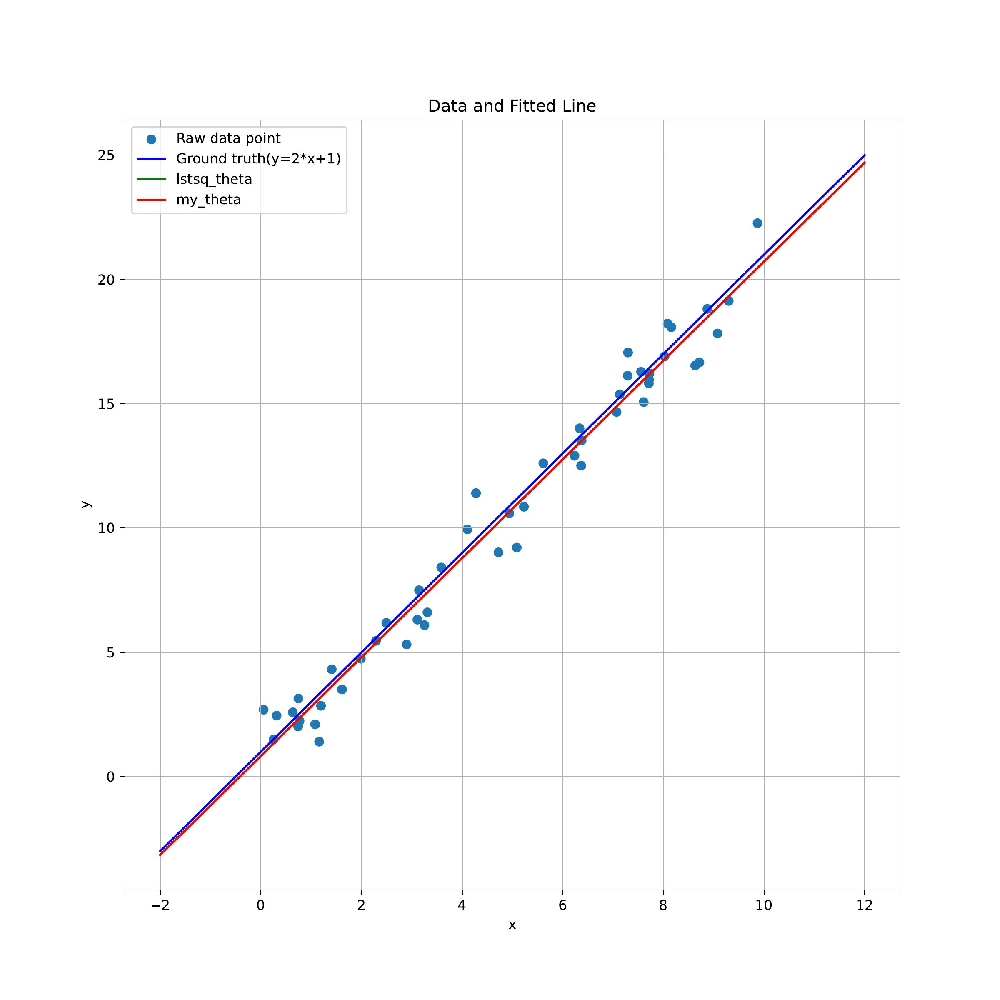

# Least Squares Regression from Scratch

## Overview

This repository is a hands-on learning project aimed at developing a deeper understanding of linear least-squares regression and gaining practical experience in scientific programming with Python and NumPy.

The project implements the normal-equation approach and compares its results with NumPy's built-in least-squares solver (`numpy.linalg.lstsq`). Through experiments with synthetic data, it explores the mathematical principles behind least-squares estimation, the conditions under which the normal-equation approach may fail, and the interpretation of regression results.

Beyond the mathematical concepts, this project also provides an opportunity to practice data visualization with Matplotlib, modular code organization, and version control using Git and GitHub. It serves as a starting point for building good habits in scientific computing and research-oriented software development.

## Mathematical Background

For observations $(x_i, y_i)$, the model is

$$
y_i = a x_i + b + \varepsilon_i,
$$

where $a$ is the slope, $b$ is the intercept, and $\varepsilon_i$ represents noise. With

$$
A =
\begin{bmatrix}
x_1 & 1 \\
x_2 & 1 \\
\vdots & \vdots \\
x_n & 1
\end{bmatrix},
\qquad
\theta =
\begin{bmatrix}
a \\ b
\end{bmatrix},
$$

least squares finds parameters that minimize the sum of squared residuals:

$$
\hat{\theta} = \arg\min_{\theta} \|A\theta-y\|_2^2.
$$

Setting the gradient $2A^\mathsf{T}(A\theta-y)$ to zero gives the normal equations:

$$
A^\mathsf{T}A\hat{\theta} = A^\mathsf{T}y.
$$

If $A$ has full column rank, $A^\mathsf{T}A$ is invertible and the solution is unique. The implementation solves this linear system with `numpy.linalg.solve`; it does not explicitly compute a matrix inverse.

If the columns of $A$ are linearly dependent, the normal-equation matrix is singular. For this model, that happens when all input values are identical. Least-squares solutions still exist, but the parameters are not uniquely determined. The custom solver returns `(None, None)` when its rank check fails; `numpy.linalg.lstsq` can return a minimum-norm least-squares solution.

Even with full column rank, forming $A^\mathsf{T}A$ can amplify numerical conditioning problems. The normal-equation method here is primarily an exercise in understanding the mathematics.

The code reports two measures of fit:

$$
\mathrm{SSE} = \sum_{i=1}^{n}(\hat{y}_i-y_i)^2,
\qquad
\mathrm{MSE} = \frac{\mathrm{SSE}}{n}.
$$

Here, MSE is the mean squared residual on the fitted data, not an estimate obtained from a separate test set.

## Implementation

The code is divided into four small modules:

| File | Responsibility |
| --- | --- |
| `data.py` | Generate synthetic observations and construct the design matrix. |
| `solver.py` | Implement the normal-equation solver and the NumPy reference solver; compute SSE from residuals. |
| `visualization.py` | Plot observations, the ground-truth line, and both fitted lines; save `result.pdf`. |
| `main.py` | Set the random seed, run both methods, report parameters and errors, compare results, and display the plot. |

The default experiment uses 50 observations generated from

$$
x_i \sim \mathcal{U}(0,10),
\qquad
\varepsilon_i \sim \mathcal{N}(0,1),
\qquad
y_i = 2x_i + 1 + \varepsilon_i.
$$

`main.py` sets `np.random.seed(42)`. The design matrix stores the input values in its first column and ones in its second column, so the returned parameter vector is ordered as `[slope, intercept]`.

Both solvers compute SSE directly from `A @ theta - y`. The script then uses `numpy.allclose` to compare their parameters, SSE, and MSE within numerical tolerances.

“From scratch” refers to implementing the regression workflow and normal equations explicitly; the project still uses NumPy for array operations and linear-system solving.

## Running the Experiment

From the repository root, install the dependencies and run the script:

```bash
python -m pip install numpy matplotlib
python main.py
```

The script prints the fitted parameters, SSE, MSE, and comparison results. It also saves `result.pdf` in the current working directory and opens the plot in a Matplotlib window.

## Experimental Results



*Figure 1. Least-squares fitting of noisy linear data. Blue markers show the observations, and the blue line shows the ground truth, y = 2x + 1. The green line (`lstsq_theta`) is the NumPy fit, and the red line (`my_theta`) is the normal-equation fit. The two fitted lines overlap at this scale, with the red line covering the green line. This PNG was exported directly from the experiment's result.pdf.*

The observations follow a clear linear trend with scatter around the ground truth. Both fitted lines track that trend and lie slightly below the ground-truth line over the displayed range. The difference from the true line is expected for a finite sample with random noise: least squares fits the observed data rather than forcing the parameters to their generating values.

Rerunning the current data-generation and solver code with seed 42 gives the following values, rounded to six decimal places:

| Method | Slope | Intercept | SSE | MSE |
| --- | ---: | ---: | ---: | ---: |
| Normal equations | 1.989200 | 0.826610 | 42.663269 | 0.853265 |
| `numpy.linalg.lstsq` | 1.989200 | 0.826610 | 42.663269 | 0.853265 |

These numbers are computed from the code, not read from the plotted image. `main.py` displays fewer decimal places because it sets NumPy's print precision to 2. All three comparisons (`theta_is_same`, `sse_is_same`, and `mse_is_same`) return `True`.

The numerical agreement supports the correctness of the custom implementation for this full-rank example. It does not establish robustness on ill-conditioned data or predictive performance on unseen observations. The lines extend beyond the sampled input interval for visualization only.

The README uses `images/least_squares_fit.png` because a PDF cannot be displayed directly with Markdown image syntax on GitHub. Commit the PNG together with this README. Running the current script updates `result.pdf`; if the experiment changes, export a new PNG and update the reported results as well.

## Learning Notes and Next Steps

This experiment connects the derivation of the normal equations to a working numerical implementation. It also provides practice with separating data generation, solving, and visualization into small modules.

Useful follow-up exercises are to make all input values identical and observe the rank check, vary the sample size or noise level, and compare behavior when the input values make the design matrix poorly conditioned. These are extensions to explore; the figure above shows only the default full-rank experiment.
